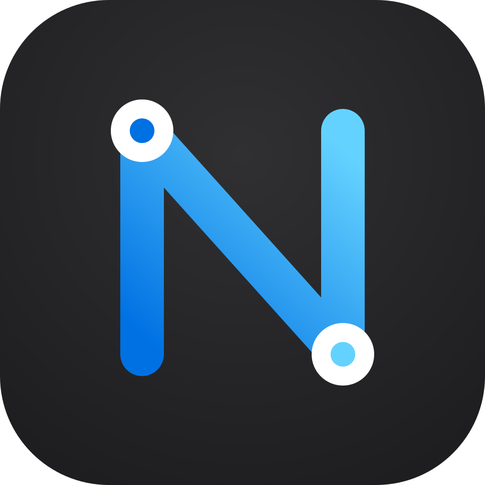
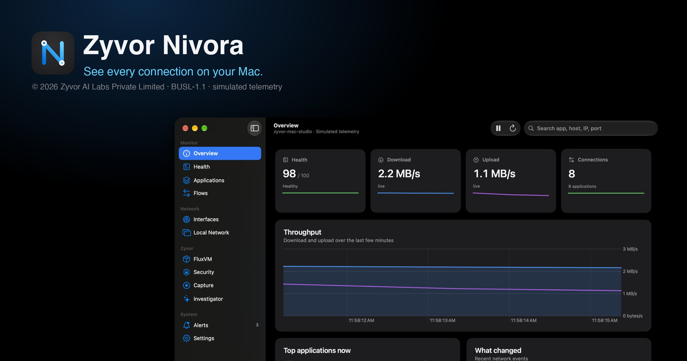
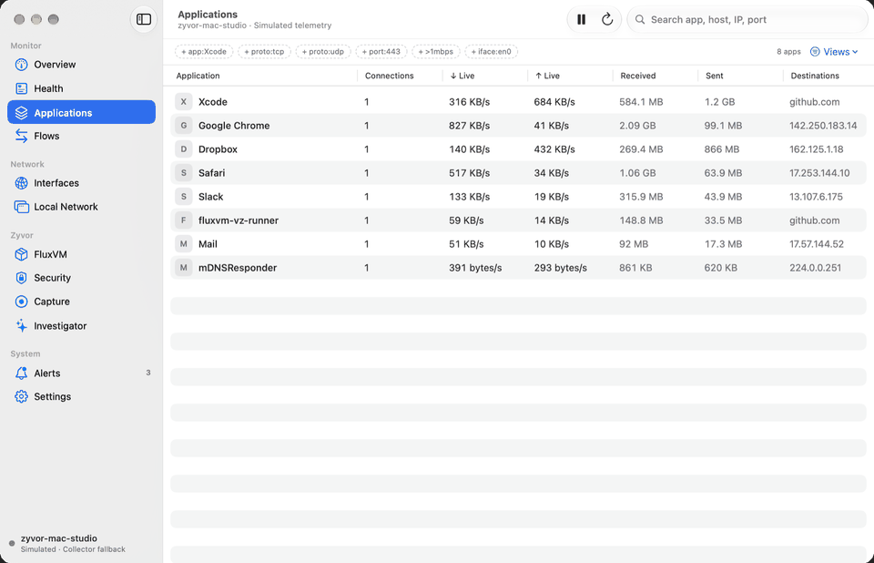
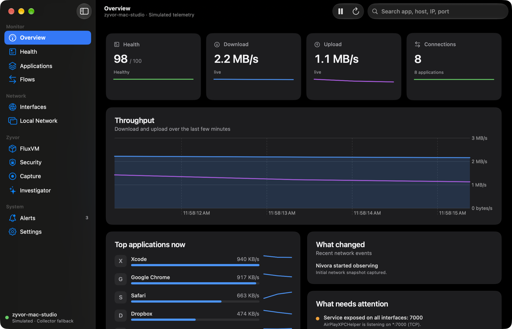
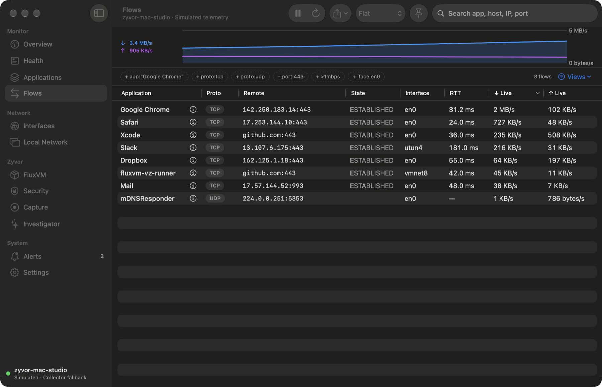

# Zyvor Nivora

### See every connection on your Mac.

**[Download](https://github.com/zyvorai/nivora/releases/tag/v0.5.4)** · **[Website](https://zyvorai.github.io/nivora/)** · **[Docs](https://zyvorai.github.io/nivora/docs/)** · **[Buy a licence](https://zyvor.dev/buy)**

This repository holds the documentation, website and downloads for Nivora. **The Nivora source code is private.**

## What Nivora is

Nivora is a Mac-native application and network intelligence app: which app is talking to what, over which interface. It shows live per-app bandwidth, flows, DNS, routes, VPNs, listeners and FluxVM workloads in a native SwiftUI app. It is local-first and observe-first: no account, no cloud, no telemetry upload, no payloads, and nothing is blocked unless you say so.

| When this happens | Nivora gives you |
| --- | --- |
| "Something is eating my bandwidth" and Activity Monitor only shows a total | Live download and upload per application, with an inspector for every app and flow |
| "What is this connection to `17.253.x.x`?" | The owning app, remote endpoint, interface (Wi-Fi, VPN, virtual), RTT and every other flow to the same host |
| "Did my VPN or DNS just change?" | A Time Machine of interface, DNS, route, VPN and listener changes |
| "Is the network actually healthy?" | A 0-100 score with explained components and a local, offline investigator |
| "I need to hand this to someone" | CSV, JSON and NDJSON exports of the current filter, optionally redacted |
| You run VMs or sandboxes with FluxVM | Workloads beside host traffic |

| Light | Dark |
| --- | --- |
|  |  |
|  |  |

*The screenshots are the native app on simulated telemetry.*

## Download, trial and requirements

- **Download:** [Nivora 0.5.4 (30-day trial)](https://github.com/zyvorai/nivora/releases/tag/v0.5.4). The release has `Nivora-0.5.4.dmg` and its `.sha256` checksum.
- **Requirements:** macOS 15 or later, Apple silicon.
- **Notarized:** the build is signed with our Apple Developer ID and notarized, so Gatekeeper opens it normally.
- **Free 30-day trial key: sales@zyvor.dev.** Enter the key under **Nivora > Licence…**.
- **Licence:** get one at https://zyvor.dev/buy. Earlier paid purchases keep their perpetual licence and need no key. Terms: [docs/COMMERCIAL-LICENSE.md](docs/COMMERCIAL-LICENSE.md).
- **Limit:** the notarized build has no content filter or capture helper (Apple's NetworkExtension entitlement is not available to us), so per-app attribution uses the collector.

Install steps: [docs/INSTALL.md](docs/INSTALL.md).

## Privacy and safety

- **Local-first:** no account, no cloud, no telemetry upload. The local API listens on loopback only.
- **Observe-first:** rules default to observe; block rules are one-hour leases and only take effect through the content filter, which is not in the notarized build.
- **No payloads:** flow metadata only. Exports can be redacted. See [SECURITY.md](SECURITY.md).

## Documentation

| Doc | Topic |
| --- | --- |
| [docs/INSTALL.md](docs/INSTALL.md) | Install, trial key and uninstall |
| [docs/ARCHITECTURE.md](docs/ARCHITECTURE.md) | How it works |
| [docs/API.md](docs/API.md) | Local HTTP API, filter grammar, exports, command line and MCP |
| [docs/CAPTURE.md](docs/CAPTURE.md) | Packet capture guarantees |
| [docs/NETWORKEXTENSION.md](docs/NETWORKEXTENSION.md) | Content filter and entitlements |
| [docs/FLUXVM.md](docs/FLUXVM.md) | FluxVM integration |
| [docs/WIDGETS.md](docs/WIDGETS.md) | Widget and Shortcuts |
| [CHANGELOG.md](CHANGELOG.md) | Release notes |

## Licence

Nivora is licensed under the [Zyvor Production License v1.0](LICENSE). It is free for non-production use; production use needs a paid commercial licence from Zyvor AI Labs Private Limited ([terms](docs/COMMERCIAL-LICENSE.md), [sales@zyvor.dev](mailto:sales@zyvor.dev)). See also [NOTICE](NOTICE).

Copyright © 2026 Zyvor AI Labs Private Limited · [zyvor.dev](https://zyvor.dev)
