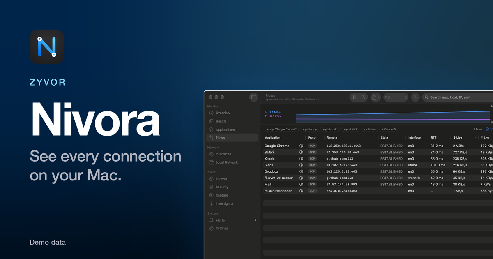
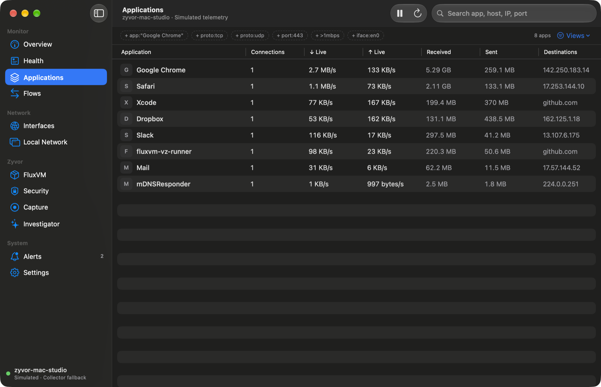
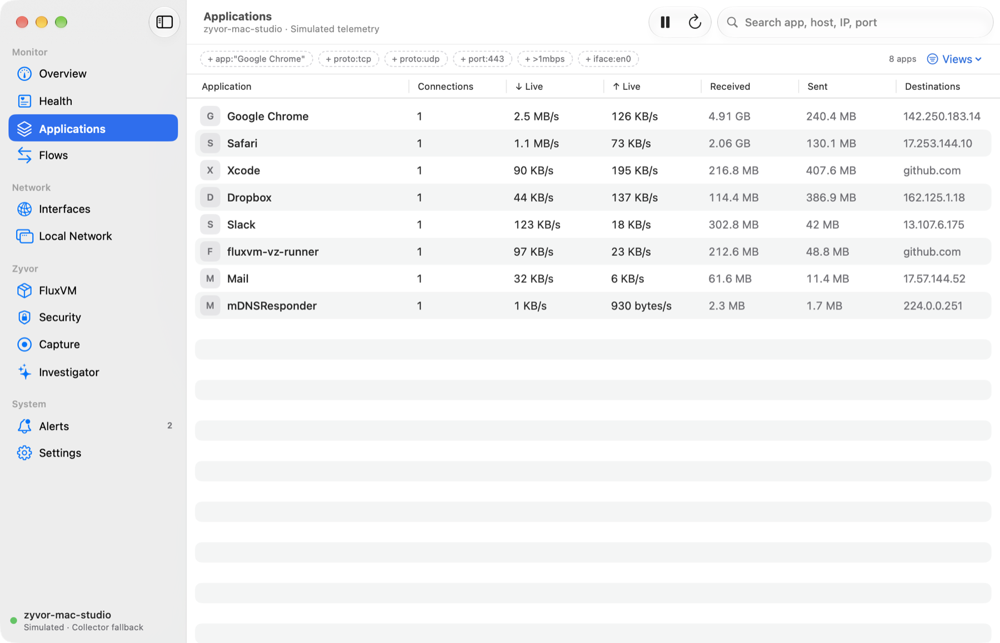
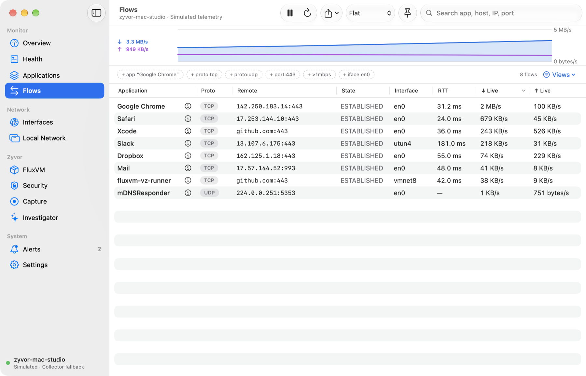
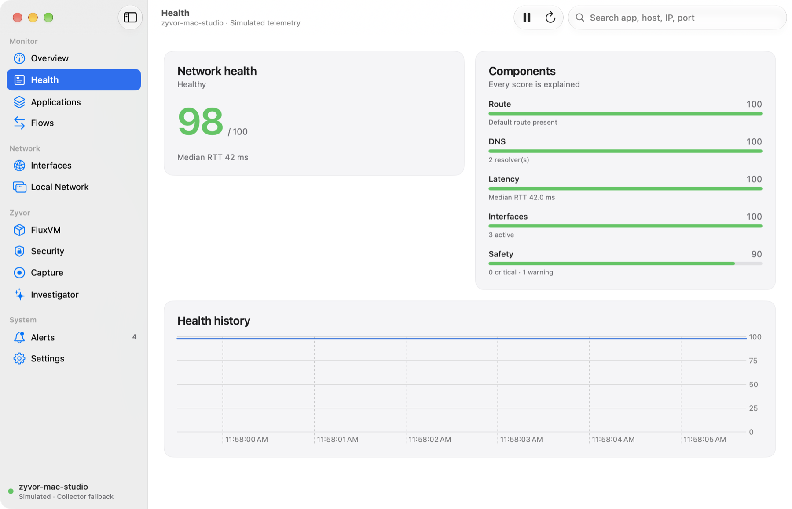
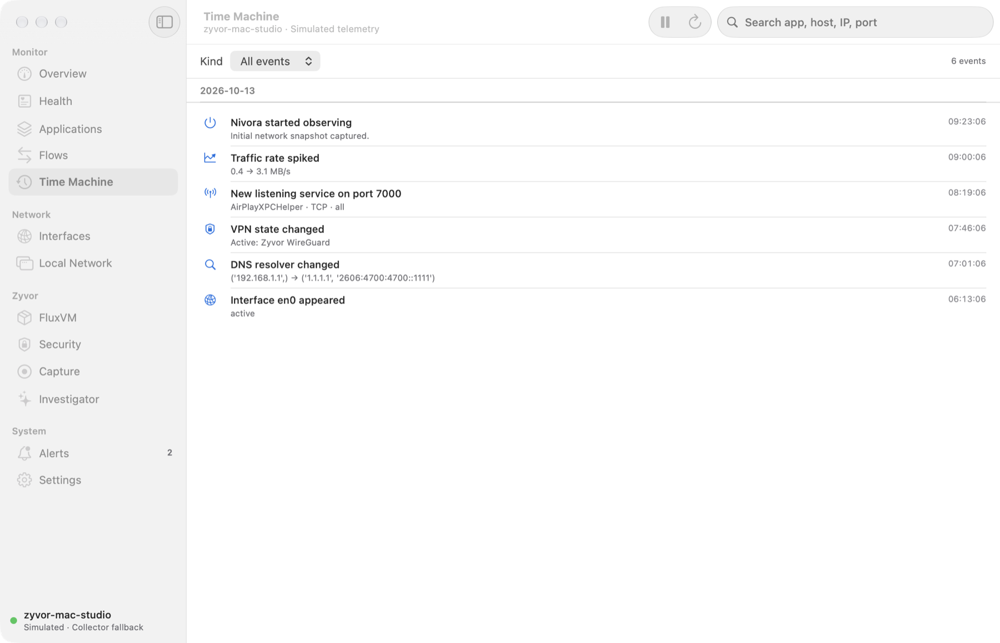
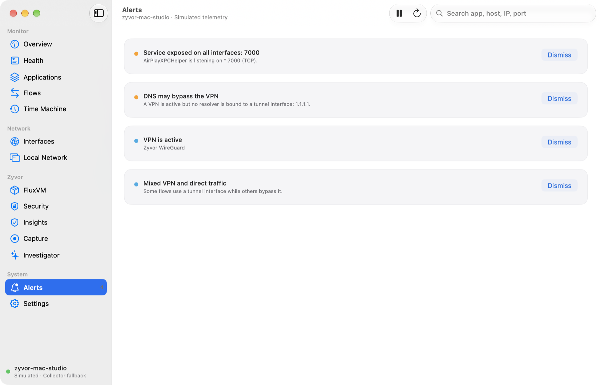

# Nivora

### See every connection on your Mac.

Which app is talking to what, over which interface. Local-first and observe-first.

 

**[Download the 30-day trial](https://github.com/zyvorai/nivora/releases/tag/v0.5.4)** &nbsp;·&nbsp; [Website](https://zyvorai.github.io/nivora/) &nbsp;·&nbsp; [Docs](https://zyvorai.github.io/nivora/docs/) &nbsp;·&nbsp; [Buy a licence](https://zyvor.dev/buy)

`Nivora-0.5.4.dmg` · macOS 15 or later · Apple silicon · signed and notarized

---

## Download (trial)

| | |
| --- | --- |
| **Get it** | [Nivora 0.5.4](https://github.com/zyvorai/nivora/releases/tag/v0.5.4): `Nivora-0.5.4.dmg` and its `.sha256` checksum |
| **Trial key** | The app runs without a key. For a free 30-day trial key, email **sales@zyvor.dev**. Enter the key under **Nivora > Licence…** |
| **Requirements** | macOS 15 or later, Apple silicon |
| **Notarized** | Signed with our Apple Developer ID. Notarized by Apple; macOS shows its standard first-open confirmation for apps downloaded from the internet |

Install steps: [docs/INSTALL.md](docs/INSTALL.md).

## See it

*Screenshots are the native app on simulated telemetry (demo data).*

| Applications | Flows |
| --- | --- |
|  |  |
|  |  |

| Health | Time Machine | Alerts |
| --- | --- | --- |
|  |  |  |

## What it does

- **Applications:** traffic grouped by app, with live download and upload rates and destinations.
- **Flows:** protocol, remote endpoint, state, interface and RTT per connection, filtered with one grammar.
- **Health:** a 0-100 score built from route, DNS, latency, interfaces and safety, with every component explained, plus a local, offline investigator.
- **Time Machine:** DNS, VPN, listener, interface and traffic-spike events, stored locally in SQLite.
- **Insights:** a per-app trust score where every point maps to a visible check.
- **Alerts:** exposed services, DNS that may bypass the VPN, mixed tunnel traffic. Alerts explain; they never block.
- **Exports:** CSV, JSON or NDJSON, optionally redacted of private IPs, MACs, SSID and hostname.
- **FluxVM:** when FluxVM is running, its VMs and sandboxes appear beside host traffic.
- **Private by design:** no account, no cloud, no telemetry upload, no payloads. Nothing is blocked unless you say so.

## Requirements

- macOS 15 or later, Apple silicon.
- **Limit:** the notarized build has no content filter or capture helper (Apple's NetworkExtension entitlement is not available to us), so per-app attribution uses the built-in collector. See [docs/NETWORKEXTENSION.md](docs/NETWORKEXTENSION.md).

## Trial and licence

- The app runs without a key. For a free 30-day trial key, email sales@zyvor.dev. The trial is soft: nothing is disabled and no data is lost when it ends.
- **Licence:** INR 999 incl. 18% GST in India (about US$10 excl. tax outside India), one-time: https://zyvor.dev/buy#nivora. Free 30-day trial above. Prices: INR incl. 18% GST in India; US dollars excl. tax elsewhere (VAT, GST or sales tax added where applicable). Pay online by UPI, card or netbanking; international cards work (charged in rupees); or request a US-dollar invoice by bank transfer. Custom pricing: contact sales@zyvor.dev. Earlier paid purchases keep their perpetual licence and need no key.
- Terms: [docs/COMMERCIAL-LICENSE.md](docs/COMMERCIAL-LICENSE.md). Licensed under the [Zyvor Production License v1.0](LICENSE); free for non-production use, production use needs a paid commercial licence from Zyvor AI Labs Private Limited ([sales@zyvor.dev](mailto:sales@zyvor.dev)). See also [NOTICE](NOTICE).

## Documentation

| Doc | Topic |
| --- | --- |
| [Website](https://zyvorai.github.io/nivora/) | The product page |
| [Install](https://zyvorai.github.io/nivora/docs/install.html) ([md](docs/INSTALL.md)) | Install, trial key and uninstall |
| [Architecture](https://zyvorai.github.io/nivora/docs/architecture.html) ([md](docs/ARCHITECTURE.md)) | How it works |
| [API](https://zyvorai.github.io/nivora/docs/api.html) ([md](docs/API.md)) | Local HTTP API, filter grammar, exports, command line and MCP |
| [Packet capture](https://zyvorai.github.io/nivora/docs/capture.html) ([md](docs/CAPTURE.md)) | Capture guarantees |
| [NetworkExtension](https://zyvorai.github.io/nivora/docs/networkextension.html) ([md](docs/NETWORKEXTENSION.md)) | Content filter and entitlements |
| [FluxVM](https://zyvorai.github.io/nivora/docs/fluxvm.html) ([md](docs/FLUXVM.md)) | FluxVM integration |
| [Widget and Shortcuts](https://zyvorai.github.io/nivora/docs/widgets.html) ([md](docs/WIDGETS.md)) | WidgetKit and Shortcuts |
| [Changelog](CHANGELOG.md) · [Security](SECURITY.md) | Release notes, reporting |

**The Nivora source code is private.** This repository holds the documentation, website and downloads.

Copyright © 2026 Zyvor AI Labs Private Limited · [zyvor.dev](https://zyvor.dev)
